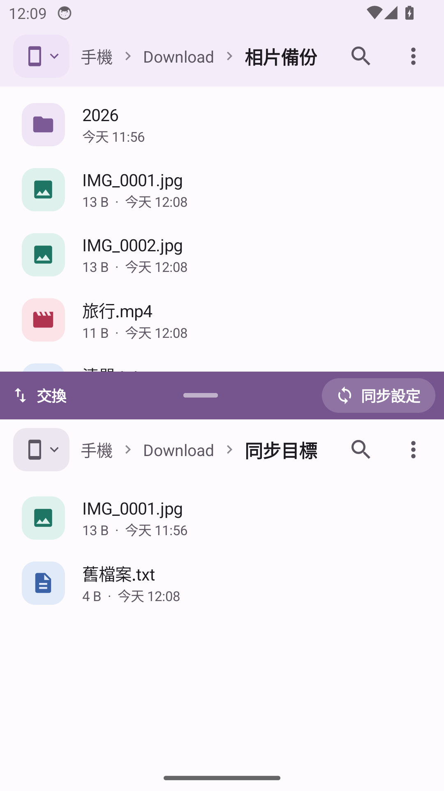
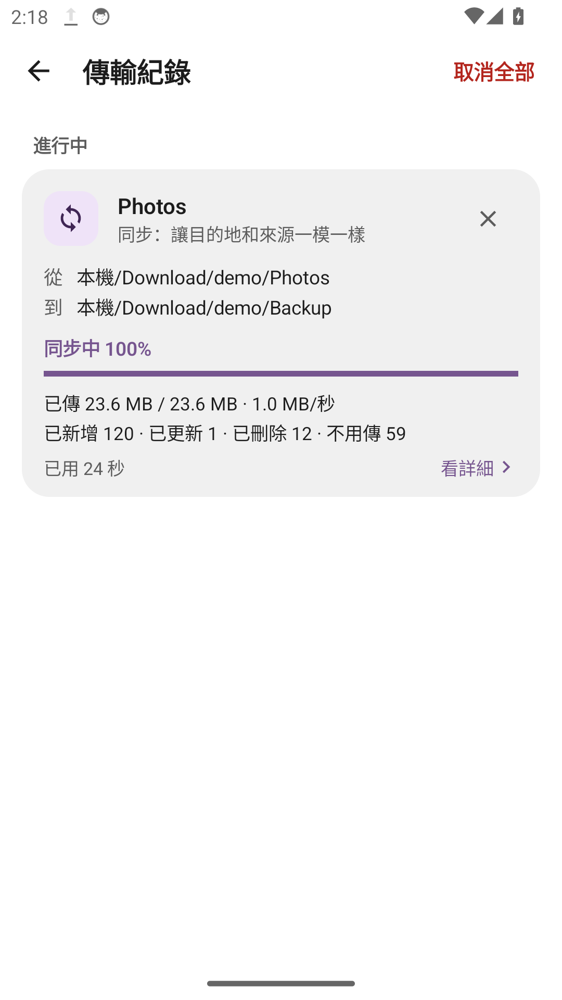
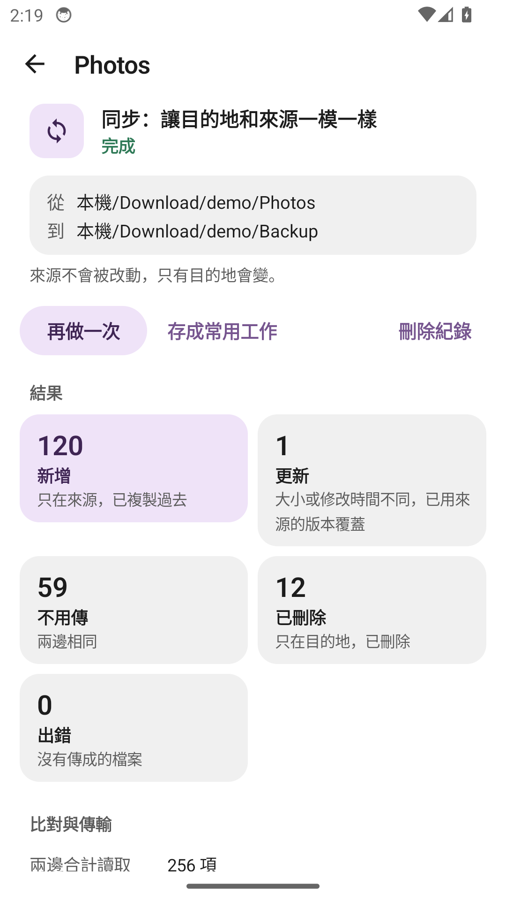

<h1 align="center">Rclone Browser Next Mobile</h1>

給 Android 的 rclone 檔案管理器。手機與雲端檔案，切換位置就能搬檔。

<a href="https://github.com/jason840709/RcloneBrowserNextMobile/releases/tag/v0.7.4">下載 0.7.4</a> · <a href="docs/USER_GUIDE.zh-TW.md">使用手冊</a> · <a href="docs/BUILD.md">建置說明</a> · <a href="https://github.com/jason840709/RcloneBrowserNextMobile/issues">回報問題</a>

*模擬器中的測試畫面，使用示意資料。雙窗格截圖來自 0.2.1，傳輸紀錄與詳細頁來自 0.7.0。*

## 這是什麼？

Rclone Browser Next Mobile 是 [Rclone Browser Next](https://github.com/jason840709/RcloneBrowserNext) 系列的 Android 檔案管理器，沿用桌面版的應用程式圖示，提供紫、藍、綠三種強調色。檔案傳輸由 [rclone](https://rclone.org/) 執行，手機介面提供單頁、分頁與上下雙窗格，方便瀏覽資料夾、複製、移動和同步。

**目前版本為 0.7.4，提供 Android ARM64 安裝包。** 最低系統設定為 Android 8。實際驗證平台為 Android 14 ARM64 模擬器，其他系統版本與實體手機仍待驗證。

## 0.7.4 更新

修正同步出錯後沒有清掉多出空資料夾的問題。個別檔案寫入失敗時，仍會確認來源並清理目的地多出的項目；來源清單可能不完整時不刪除。

寫入 FAT／exFAT 記憶卡或 USB 隨身碟時，結尾是句點或空格的名稱會略過，不會為了寫入而自動改名。詳細頁與匯出的傳輸報告會列出略過的名稱、刪除的資料夾，以及各資料夾的錯誤數。

傳輸詳細頁可按「匯出報告」儲存並分享設定、結果與錯誤，方便回報問題。報告含檔案路徑、連線名稱與裝置資訊，分享前請先檢查全文。

## 手機上怎麼用？

### 一次看一個資料夾，或同時看兩個位置

單頁模式把畫面留給檔案清單；分頁可以輪流查看兩個位置；上下雙窗格適合在來源和目的地之間搬檔。長按選取後，複製與移動按鈕才會出現。傳輸進度也只在工作進行時顯示。

### 本機與遠端共用操作方式

NAS 是區域網路中的檔案儲存設備。App 提供 NAS 常用的檔案分享連線 SMB、加密檔案傳輸連線 SFTP，以及透過網址讀寫檔案的 WebDAV 連線表單。其他雲端服務可匯入既有、整份未加密的 rclone 設定檔。目前沒有內建雲端帳號的瀏覽器登入流程。

一般複製與移動會略過目的地已有的同名檔案。移動時，被略過的來源仍保留。背景傳輸可從系統通知或 App 的「傳輸紀錄」查看進度，進行中與排隊中的工作都能單獨取消。

### 同步可以先比對，也能直接開始

雙窗格提供兩種單向操作：

| 方式 | 目的地會發生什麼事 |
| --- | --- |
| 只補上缺少的檔案 | 複製目的地沒有的檔案，不覆蓋或刪除既有檔案 |
| 讓目的地和來源一模一樣 | 依選定的比對方式更新不同的檔案，刪除目的地多出的檔案 |

最後點過的窗格預設為來源，另一個窗格為目的地。同步設定面板可對調方向。兩種方式都不修改來源。「先比對」會列出變更，確認後才執行；「直接開始」會立即執行，其中「讓目的地和來源一模一樣」會再確認一次。比對可以停止，沒有總時間上限。取消會保留已完成的變更，沒有一鍵還原。

## 快速開始

APK 是 Android 的安裝包。

1. 從[發布頁](https://github.com/jason840709/RcloneBrowserNextMobile/releases/tag/v0.7.4)下載 APK，在 ARM64 手機上安裝。
2. 第一次開啟時，按「允許檔案存取」完成系統授權。開始傳輸時可允許顯示通知。
3. 點窗格左上角的手機或雲朵圖示，選擇位置、新增連線，或匯入 rclone 設定。
4. 長按選取檔案，按「複製」或「移動」，前往目的資料夾後按「貼上」。雙窗格可直接傳送到另一側。

## 已驗證範圍

0.7.4 在 Android 14 ARM64 模擬器通過 **138 項引擎自動檢查**與 **17 項畫面流程檢查**，涵蓋本機與測試 WebDAV 傳輸、內容核對、同名保護、取消、同步比對與刪除，並檢查錯誤分類、空資料夾清理、記憶卡名稱略過與報告匯出。

尚未完成實體 NAS 測速、SMB／SFTP 伺服器登入傳檔，以及實體手機的省電與長時間傳輸驗證。程序被系統終止後不會自動續傳。重新貼上會略過已存在的檔案，因此中斷後應先確認目的地檔案是否完整。

## 文件與回報

- [使用手冊](docs/USER_GUIDE.zh-TW.md)：瀏覽、複製、移動、同步與連線設定。
- [建置說明](docs/BUILD.md)：取得引擎、編譯、簽章與輸出位置。
- [0.7.4 發布說明](docs/RELEASE_0.7.4.md)：版本內容、需求與已知限制。

回報問題時，請提供 App 版本、Android 版本、連線類型與重現步驟。請勿張貼密碼、權杖或完整的個人連線設定。

## 授權與致謝

程式採 [MIT License](LICENSE)。rclone 引擎的授權與來源見[第三方元件說明](assets/THIRD-PARTY.txt)。應用程式圖示與桌面版共用。
