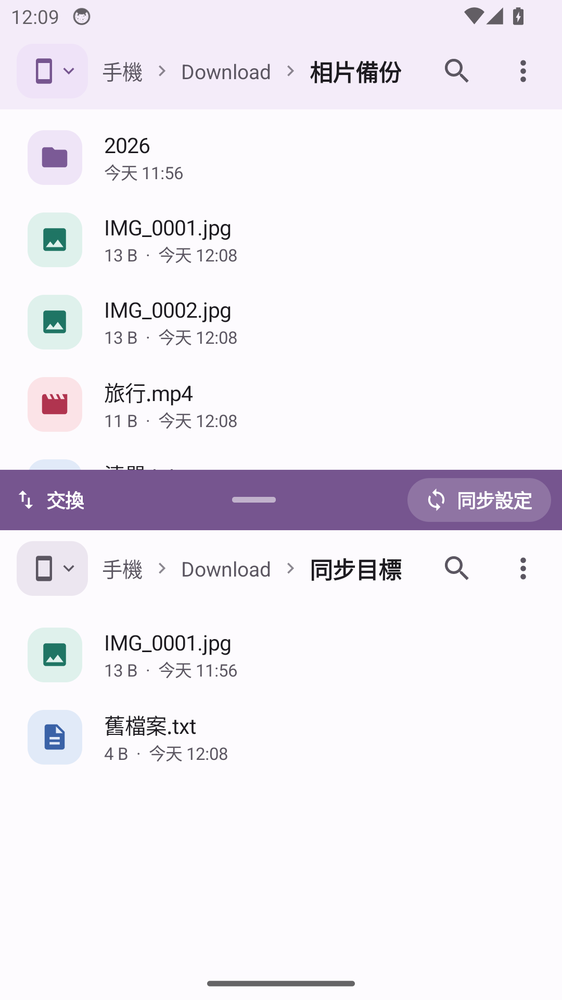
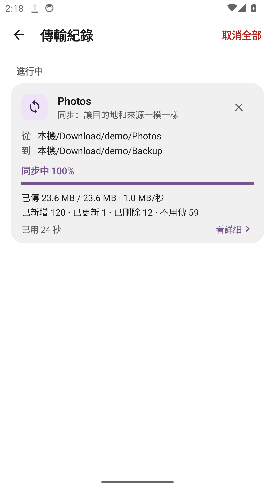
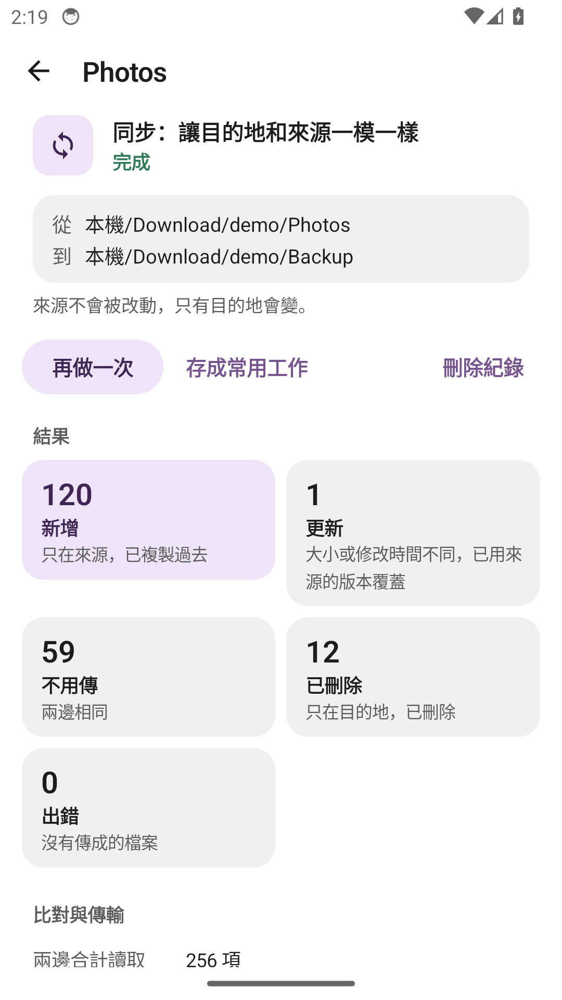

<h1 align="center">Rclone Browser Next Mobile</h1>

Android 版 rclone 檔案管理器，在本機與遠端之間輕鬆搬移、同步檔案。

<a href="https://github.com/jason840709/RcloneBrowserNextMobile/releases/tag/v0.8.0">下載 0.8.0</a> · <a href="docs/USER_GUIDE.zh-TW.md">使用手冊</a> · <a href="docs/BUILD.md">建置說明</a> · <a href="https://github.com/jason840709/RcloneBrowserNextMobile/issues">回報問題</a>

*畫面以示意資料呈現。*

## 簡介

Rclone Browser Next Mobile 是 [Rclone Browser Next](https://github.com/jason840709/RcloneBrowserNext) 的 Android 版本，沿用桌面版圖示，提供紫、藍、綠三種配色。底層傳輸由 [rclone](https://rclone.org/) 執行，支援單頁、分頁與上下雙窗格，方便瀏覽、複製、移動與同步檔案。

**目前版本為 0.8.0（Android ARM64，需 Android 8 以上）。** 可直接覆蓋安裝 0.7.6，保留既有設定與連線。

## 0.8.0 更新重點

- 改寫介面、操作說明與使用手冊，補清楚同步、略過與刪除的條件。
- 本機與記憶卡重新命名改用系統操作，直接更改名稱；支援直接改名的遠端連線會使用伺服器功能。
- 同一儲存空間內，移動到尚不存在的目的資料夾時，可直接移動整個資料夾，傳輸紀錄也會顯示整個資料夾的移動結果。

## 主要功能

### 單頁、分頁與雙窗格

單頁模式可專注瀏覽單一資料夾；分頁模式可切換兩個位置；雙窗格適合在來源與目的地之間對傳。長按選取檔案後才會顯示複製、移動等操作列，平常不佔畫面空間。

### 本機與遠端連線

內建 SMB、SFTP 與 WebDAV 連線表單，方便連上 NAS 或伺服器；Google 雲端硬碟、OneDrive 等雲端服務可匯入未加密的 `rclone.conf` 設定檔（暫無內建瀏覽器 OAuth 登入）。

一般複製與移動遇到同名檔案會直接略過（移動時保留來源檔案）。背景傳輸可從系統通知或「傳輸紀錄」查看進度，進行中與排隊中的工作皆可單獨取消。

### 單向同步（可先比對或直接開始）

雙窗格中間的「同步設定」提供兩種單向同步模式（皆只修改目的地，不動來源）：

| 方式 | 說明 |
| --- | --- |
| 只補上缺少的檔案 | 僅複製目的地缺少的檔案，不覆蓋也不刪除原有檔案 |
| 讓目的地和來源一模一樣 | 依比對方式覆蓋不同檔案，並刪除目的地多出的檔案 |

最後點選的窗格預設為來源，可按「對調」反轉方向。「先比對」會先預覽變更清單（不限時間，可中途停止），確認後才執行；「直接開始」省略比對，其中「讓目的地和來源一模一樣」仍會再確認。取消同步會保留已完成的變更，無法一鍵復原。

## 快速開始

1. 從[發布頁](https://github.com/jason840709/RcloneBrowserNextMobile/releases/tag/v0.8.0)下載 APK 並安裝於 ARM64 手機。
2. 首次開啟時點「允許檔案存取」授權讀寫本機檔案；開始傳輸時可授權顯示進度通知。
3. 點左上角位置圖示，切換儲存空間、新增遠端連線或匯入 rclone 設定檔。
4. 長按選取檔案即可複製、移動；在雙窗格可直接傳往另一側或執行同步。

## 使用限制

App 被系統強制終止後不會自動續傳。由於重新貼上會略過同名檔案，中斷後請先確認目的地有沒有留下不完整檔案。

## 文件與問題回報

- [使用手冊](docs/USER_GUIDE.zh-TW.md)：瀏覽、複製、移動、同步與連線設定。
- [建置說明](docs/BUILD.md)：下載引擎、編譯與簽章方式。
- [0.8.0 發布說明](docs/RELEASE_0.8.0.md)：更新內容與已知限制。

回報問題請附上 App 版本、Android 版本、連線類型與重現步驟，並留意勿貼出密碼、Token 或完整設定檔。

## 授權與致謝

本專案採 [MIT License](LICENSE) 授權。內附 rclone 引擎之來源與授權請見[第三方元件說明](assets/THIRD-PARTY.txt)。
